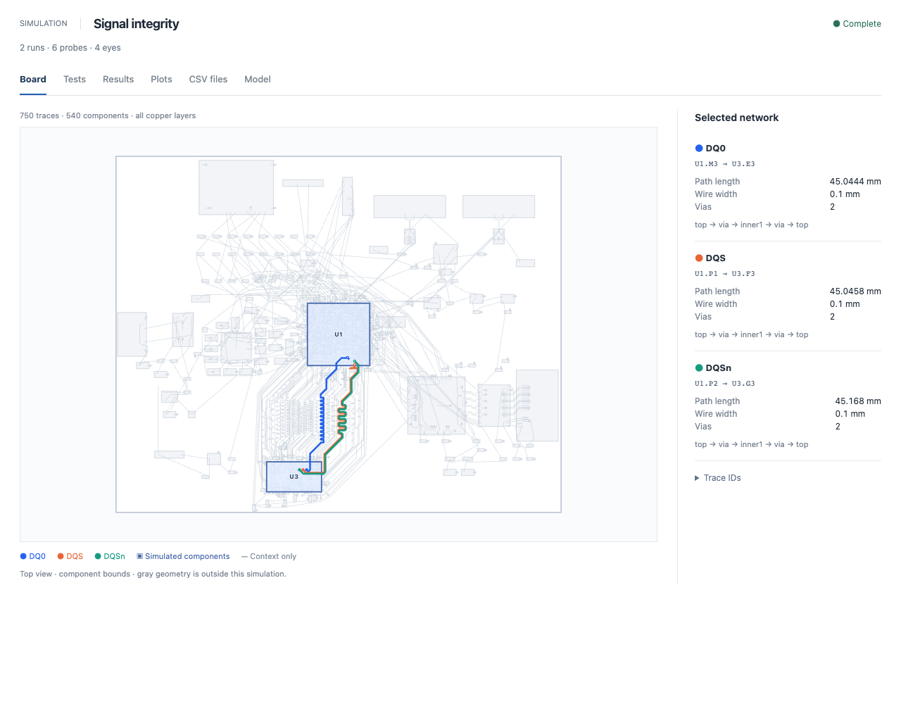
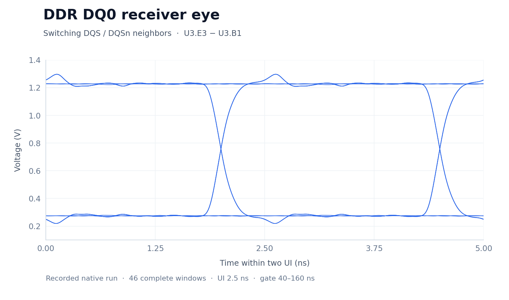
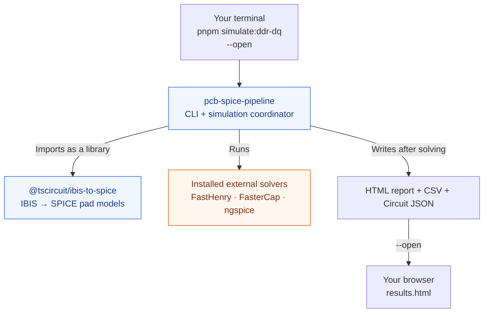
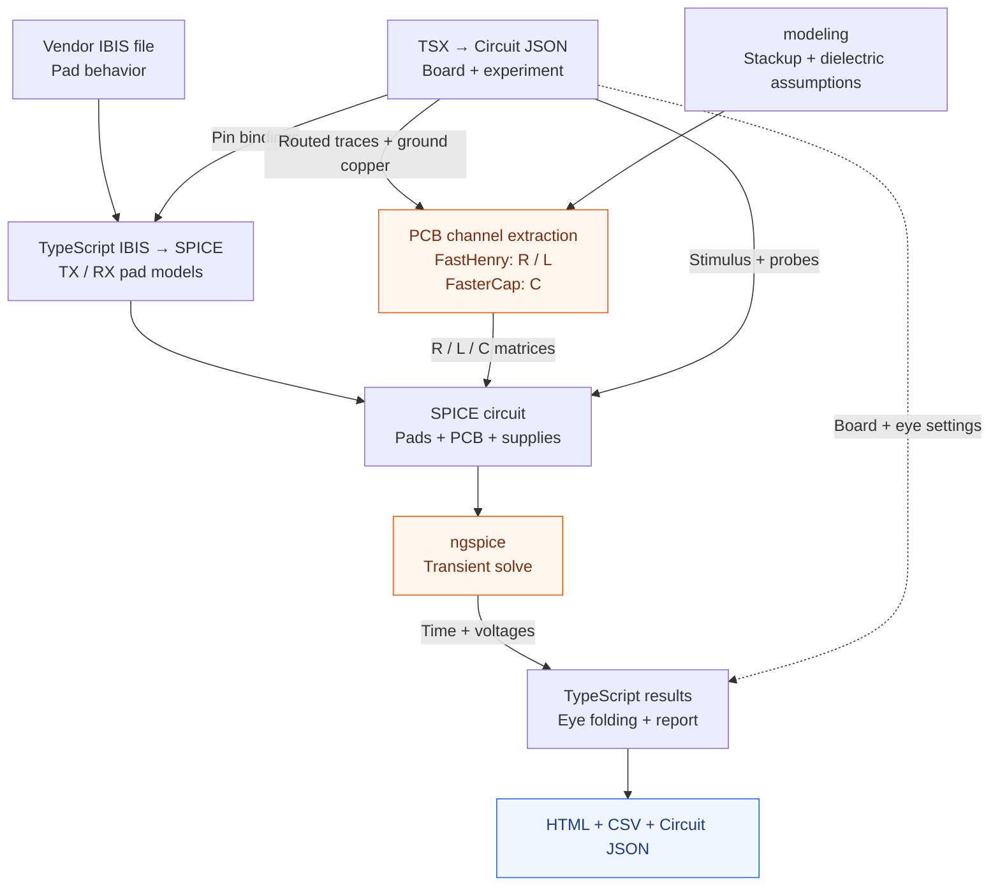
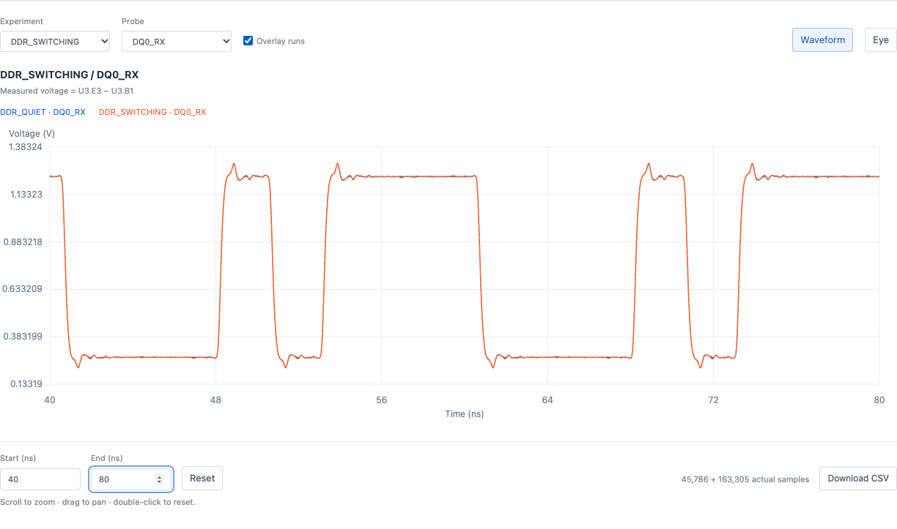

# IBIS + PCB simulation in tscircuit

Write the board and simulation in TSX, run the local solvers, then inspect the board, waveforms, eyes, and CSV data in a browser. This README walks through the API using a real TI IBIS model and recorded simulation output.

**Integration status:** the examples run locally against pinned PR previews of [core](https://github.com/tscircuit/core/pull/4765), [props](https://github.com/tscircuit/props/pull/945), and [Circuit JSON](https://github.com/tscircuit/circuit-json/pull/908). This is the API to review before upstream integration; use the checked-in lockfile.

## HTML report and eye diagram

**[Download the historical DDR report: HTML + CSV](assets/simulation-api/ddr-report.zip?raw=1).** This report and all recorded DDR plots and numeric results below use the earlier straightened traces and artificial return strip. They do not validate the current routed-copper model. Unzip it and open `results.html` in your browser, keeping `csv/` beside it. It contains the DQ0 + DQS + DQSn simulation with quiet and switching experiments, six probes per experiment, and four eyes. To create a new run with the actual ground copper, use `pnpm simulate:ddr-dq --open` after [setup](#set-up-once).

| HTML report interface — historical strip model | DDR DQ0 receiver eye — historical strip model |
| --- | --- |
| [](assets/simulation-api/html-report.png) | [](assets/simulation-api/ddr-eye.png) |

Click either preview to enlarge it. To reproduce the eye view, choose **Plots → DDR_SWITCHING → DQ0_RX → Eye** in the downloaded report. It measures `U3.E3 − U3.B1` over 40–160 ns: 46 complete windows, 2.5 ns UI, and approximately 0.219–1.297 V. The folds use recorded samples with linear interpolation; no artificial jitter is added. **Board**, **Tests**, **Results**, and **CSV files** show the circuit, test settings, measurements, and exports.

## Start here: the CLI and the two packages

**`pcb-spice-pipeline` is the CLI that runs the whole simulation.** After [setup](#set-up-once), run the three-trace DDR example directly:

```sh
pnpm exec pcb-spice-pipeline examples/ddr-dq/index.circuit.tsx --open
```

The repository shortcut `pnpm simulate:ddr-dq --open` runs that same CLI with that same file. `--open` opens the generated `results.html` after the simulation finishes.



| Folder | Used here as | Responsibility |
| --- | --- | --- |
| [packages/pcb-spice-pipeline](packages/pcb-spice-pipeline) | `pcb-spice-pipeline` CLI | Loads TSX and modeling settings, calls the converter and solvers, and writes the results. |
| [packages/ibis-to-spice](packages/ibis-to-spice) | `@tscircuit/ibis-to-spice` library | Converts the selected IBIS pads into SPICE models for the runner. |

The runner calls the converter's TypeScript API, `convertIbisModelToSpice`. You do not need to run its standalone `ibis-to-spice` command for a circuit simulation. FastHenry, FasterCap, and ngspice are installed separately; neither package bundles them.

**Recommended tscircuit command:** extend the existing `tsci simulate analog` command to use this backend when the TSX declares `spiceEngine="pcb_spice"`. The proposed invocation is:

```text
tsci simulate analog examples/ddr-dq/index.circuit.tsx --open
```

This backend dispatch and `--open` support are proposed integration work. The checked-in tscircuit CLI's analog command does not run this pipeline yet; use the runnable command above today.

## Technical workflow



**IBIS describes the chip's electrical pads. The field solvers describe the PCB channel. ngspice solves them together.** FastHenry extracts resistance (R) and inductance (L); FasterCap extracts capacitance (C). The stimulus drives an output pad directly; this does not simulate the chip's internal digital logic. Orange boxes use separately installed native programs. The runner, IBIS conversion, and report generation use TypeScript; Python is not required.

## What a person supplies

**You write the circuit/test in TSX, choose the IBIS bindings, and export a `modeling` object with the physical assumptions.** This section lists the authored inputs, not generated design data or solver output.

`simulation.config.ts`, `simulation.json`, and `models.ts` are organizational conventions, not automatically discovered files or additional tscircuit formats. The entry imports what it needs and exports `modeling`; you can keep it in the entry itself. Existing examples need their imported files, but a new circuit does not need every file below.

| File you write or edit | Purpose | What you choose |
| --- | --- | --- |
| [index.circuit.tsx](index.circuit.tsx) | Circuit and experiment | Board design/reference, IBIS attachments, buffer states, stimulus bits, timing, probes, and eye settings. |
| [simulation.config.ts](simulation.config.ts) | Physical simulation configuration | Assembles and exports `modeling`. The default DDR example also defines its `driver` and `receiver` IBIS bindings here. |
| [simulation.json](simulation.json) | Optional split of the physical settings | Selected lane endpoints, conductivity, extraction mode/controls, dielectric and via assumptions. Imported by `simulation.config.ts`; **not a complete standalone CLI input**. |
| [board-construction.json](board-construction.json) | Construction facts and assumptions | Copper layer z ranges and construction notes. The config copies `copperLayers` into `modeling.stackup`; the DDR model uses `relativePermittivity` for a homogeneous dielectric approximation. |
| [models.ts](examples/single-ended/models.ts) | IBIS model bindings | Asset paths/URLs, component/model names, pin/rail mappings, corner, and package policy. The CMOS/RS-485 examples keep these in a separate module. |

Optional source notes belong in [source-provenance.json](source-provenance.json): chosen board origin/revision, attribution, evidence URLs, assumptions, and limitations. It documents those choices rather than configuring the solver. Calculated hashes/counts in the existing file are evidence, not values a person needs to author.

[tscircuit.config.json](tscircuit.config.json) is ordinary project setup for preview/build entrypoints and ignored outputs, separate from the simulation inputs above.

### Which values require a human decision?

These choices remain explicit; routed-copper extraction infers ground-net membership and reads copper shapes from the saved board:

| Human decision | Where it is supplied |
| --- | --- |
| Which pads/models to use, pin-to-port and rail mappings, corner, package policy | `ibismodel` definitions in `models.ts` or `simulation.config.ts` |
| Output/input states, traffic, duration, maximum time step, measured voltages, eye UI/origin/gates | Native simulation elements in the circuit TSX |
| Which one to three channels to simulate and their electrical reference | `modeling.lanes` (`port`, `from`, `to`; optional `sourceTraceId`) and `channelReference` |
| Copper layer z ranges, conductivity, dielectric approximation | `modeling.stackup`, `conductivitySm`, and `relativePermittivity` for `reduction: "routed-copper"`; the other examples use `profiles` for assumed spacing and return strips |
| Frequency range/model frequency, mesh/refinement, tolerances, lumped-section count | `modeling.extraction` (including `groundMeshMm` for routed copper) and `sections` |
| Via plating/equivalent-width/stub assumptions, when routes include vias | `viaPlatingMm`, `viaEquivalentWidthMm`, `omitThroughViaStubs` |
| Supply voltages and included passive components | Physical TSX voltage sources or `modeling.supplies`; explicit `modeling.passiveComponents` selection |
| Which manufacturer's model source to use | IBIS asset path/URL in the model bindings; the repository examples pin their sources in vendor locks |

For both [index.circuit.tsx](index.circuit.tsx) and [examples/ddr-dq/index.circuit.tsx](examples/ddr-dq/index.circuit.tsx), the shared `simulation.json` selects `reduction: "routed-copper"`. `simulation.config.ts` adds construction data, IBIS bindings, a supply/reference, and source evidence. The TSX declares the **experiment and timing**. The [CMOS configuration](examples/single-ended/simulation.config.ts) keeps its physical settings directly in TypeScript and retains `straightened-stages`.

Route measurements, model conversion, and solver results are computed automatically. They are not additional input files to write.

### How the DDR ground copper is selected

The extractor follows `channelReference` (`U1.A1`) through source-trace connectivity to one `source_net` marked `is_ground`, then selects the `pcb_copper_pour` records on that connected net. It infers the receiver ground pin (`U3.B1`) from the receiver's IBIS pulldown/ground-clamp reference mappings; `groundReturn` can select it explicitly when those mappings are ambiguous. Missing or ambiguous ground geometry produces an error, rather than substituting a return strip.

The saved DDR board supplies three ground pours with their polygon boundaries and 392 cutouts. Original signal XYZ coordinates, bends, widths, and the two physical reference leads/vias are retained; `stackup` supplies copper height and thickness. There is no manually chosen return width, length, or sideways offset in this mode. See [copper.ts](packages/pcb-spice-pipeline/src/copper.ts) for selection and solver geometry.

FastHenry discretizes the ground polygons into an adaptive rectangular conductor mesh with finite contact areas at the reference connections. Cutout boundaries and edge-strip extents are mesh approximations. `extraction.groundMeshMm` controls the base mesh spacing, which is halved for the convergence check alongside filament refinement. FasterCap uses closed Boolean unions of copper solids and preserves the polygon holes; duplicate/collinear Boolean artifacts below the saved coordinate precision are removed before triangulation. The capacitance calculation uses the explicit homogeneous `relativePermittivity: 4.1` assumption; dielectric layers are not solved separately.

Routed FasterCap decks use numeric millimetres to keep fine copper edges above the solver's absolute panel-size thresholds. The pipeline multiplies the raw capacitance matrix by `0.001` to restore physical farads; FastHenry decks retain metre coordinates. Both conversions are recorded and independently audited.

## 1. Attach real IBIS models

The [DDR example](examples/ddr-dq/index.circuit.tsx) drives three channels from the AM3352 (`U1`) to the Winbond DDR memory (`U3`): DQ0 data and the complementary DQS/DQSn strobes. Setup downloads their IBIS files using the URLs and hashes in [vendor-models.json](vendor-models.json).

The root [simulation.config.ts](simulation.config.ts) defines the DQS pair; the DDR example adds DQ0. Expanded into one object, the driver binding is:

```ts
import type { IbisModelDefinition } from "@tscircuit/props"

const driver: IbisModelDefinition = {
  ibisModelAsset: {
    project_relative_path: "models/sprm552c.ibs",
    url: "./models/sprm552c.ibs",
    mimetype: "text/plain",
  },
  ibisComponentName: "am335x_zcz",
  ibisPinNameToPortLabel: { P1: "P1", P2: "P2", M3: "M3", E5: "E5", A1: "A1" },
  ibisPinNameToModelName: { P1: "Model_655", P2: "Model_847", M3: "Model_343" },
  ibisPinNameToReferencePortLabels: {
    P1: { pullup: "E5", pulldown: "A1", powerClamp: "E5", groundClamp: "A1" },
    P2: { pullup: "E5", pulldown: "A1", powerClamp: "E5", groundClamp: "A1" },
    M3: { pullup: "E5", pulldown: "A1", powerClamp: "E5", groundClamp: "A1" },
  },
  modelValueCorner: "typical",
  includePackageParasitics: false,
}
```

`project_relative_path` locates the extracted file from the project root. IBIS pin `M3` binds to TSX port `M3` for DQ0; its supply references bind to `E5` and `A1`. The receiver uses `models/W631GG6MB-12.ibs`, component `W631GG6MB-12`, and model `ODT_60` for pins `E3`, `F3`, and `G3`, with supply/reference pins `A1` and `B1`.

The runner reads the local `.ibs` first. If it is missing, an HTTP(S) `ibisModelAsset.url` can provide the **plain IBIS file**; a vendor ZIP or download-page URL cannot. The examples prepare local files and check their expected hashes.

## 2. Declare the experiment in TSX

This is the switching experiment from [examples/ddr-dq/index.circuit.tsx](examples/ddr-dq/index.circuit.tsx), expanded from its quiet/switching loop. The file imports `analog` from `@tscircuit/core`, `ImportedBoard` from `pcb-spice-pipeline/tsx`, the saved board, and the bindings above:

```tsx
<ImportedBoard circuitJson={routedBoard}>
  <ibismodel componentRef="chip.U1" {...driver} />
  <ibismodel componentRef="chip.U3" {...receiver} />

  <analog.transientsimulation
    spiceEngine="pcb_spice"
    name="DDR_SWITCHING"
    duration="160ns"
    timePerStep="10ps"
    ibisPinStates={{
      ".U1 > .M3": { isOutput: true, isOutputEnabled: true },
      ".U1 > .P1": { isOutput: true, isOutputEnabled: true },
      ".U1 > .P2": { isOutput: true, isOutputEnabled: true },
      ".U3 > .E3": { isOutput: false },
      ".U3 > .F3": { isOutput: false },
      ".U3 > .G3": { isOutput: false },
    }}
  />
  <analog.digitalstimulus
    name="DQ0_SWITCHING" simulationRef=".DDR_SWITCHING" drives=".U1 > .M3"
    unitInterval="2.5ns" startTime="0ns" initialState={0}
    pattern={{ type: "bits", bits: "00010111", repeat: true }}
  />
  <analog.digitalstimulus
    name="DQS_P_SWITCHING" simulationRef=".DDR_SWITCHING" drives=".U1 > .P1"
    unitInterval="2.5ns" startTime="1.25ns" initialState={0}
    pattern={{ type: "bits", bits: "01", repeat: true }}
  />
  <analog.digitalstimulus
    name="DQS_N_SWITCHING" simulationRef=".DDR_SWITCHING" drives=".U1 > .P2"
    unitInterval="2.5ns" startTime="1.25ns" initialState={0} inverted
    pattern={{ type: "bits", bits: "01", repeat: true }}
  />

  <voltageprobe name="DQ0_RX" connectsTo=".U3 > .E3" referenceTo=".U3 > .B1" />
  <voltageprobe name="DQ0_TX" connectsTo=".U1 > .M3" referenceTo=".U1 > .A1" />
  <voltageprobe name="DQS_RX" connectsTo=".U3 > .F3" referenceTo=".U3 > .B1" />
  <voltageprobe name="DQSn_RX" connectsTo=".U3 > .G3" referenceTo=".U3 > .B1" />
  <voltageprobe name="DDR_RX" connectsTo=".U3 > .F3" referenceTo=".U3 > .G3" />
  <voltageprobe name="DDR_TX" connectsTo=".U1 > .P1" referenceTo=".U1 > .P2" />
  <analog.eyediagram
    name="DQ0_receive_eye_SWITCHING"
    simulationRef=".DDR_SWITCHING" probeRef=".DQ0_RX"
    unitInterval="2.5ns" timeOrigin="0ns" startTime="40ns"
  />
</ImportedBoard>
```

`ibismodel` attaches pad behavior to each chip. `transientsimulation` sets the engine, timing, and six pad states. DQ0 repeats the fixed `00010111` pattern (not PRBS) at 2.5 ns per bit, or **400 MT/s**. DQS/DQSn use opposite patterns offset by half a bit. Probes name the measured voltages. The eye skips the first **16 UIs (40 ns)** and retains only complete two-UI windows inside the 40–160 ns gate.

Folding uses the declared stimulus origin (`timeOrigin`, matching the stimulus start), with bit boundaries `b_k = timeOrigin + k * UI`. Each two-UI window spans `[b_k - UI/2, b_k + 3*UI/2]`, so its center is `b_k + UI/2`: half a UI after a bit edge, at mid-bit. For DQ0, the first retained window is 41.25–46.25 ns, centered at 43.75 ns. A gate that contains no complete aligned window fails with its start/end, UI and skipped-UI count; even a 40–45 ns gate is too short at this alignment.

Run the [complete circuit](examples/ddr-dq/index.circuit.tsx), which also declares the DQS receiver eye and the quiet-neighbor experiment. In the quiet experiment, the DQ0 bits stay identical while DQS/DQSn are held low/high. Its exported `modeling` selects the three routes and defines the supply, stackup, ground reference, and routed-copper extraction assumptions. `chip.U1` and `chip.U3` disambiguate the chip bindings from similarly named BGA pins.

### Known gaps

- DQ folds on the stimulus clock, without alignment to received DQS crossings.
- No VREF, AC/DC input thresholds, or setup/hold mask is applied yet. Winbond `Vinl = 0.6 V` / `Vinh = 0.9 V` are reference values only.
- No per-experiment IBIS model selection (`ODT_60` / `ODT_off` / `DATA_40`) is available yet.
- Stackup, extraction assumptions, and channel selection live in the separate modeling config.

## 3. Run it and inspect the output

After [setup](#set-up-once), run the complete DDR example:

```sh
pnpm simulate:ddr-dq --open
```

**`--open` opens the generated HTML report in your browser after the solve finishes.** Leave it off to save results without opening a browser. Each run creates a fresh folder and prints its location.



These historical plots use the same straightened-trace/return-strip DDR run as the downloadable report above. The interactive HTML adds the board view, experiment/probe selection, plot overlays, zoom/pan, and CSV downloads. Unused traces and components are gray; the three simulated traces and their chips are highlighted.

| Historical DDR strip-model result | Value |
| --- | --- |
| Selected routes | DQ0 `U1.M3 → U3.E3`; DQS `U1.P1 → U3.F3`; DQSn `U1.P2 → U3.G3` |
| Routed lengths | 45.044, 45.046, and 45.168 mm respectively; two vias each |
| Experiments | `DDR_QUIET` and `DDR_SWITCHING`; 160 ns each; 10 ps maximum integration step |
| Waveform data | Six probes; 45,786 quiet / 163,305 switching adaptive timestamps |
| DQ0 receiver eye | 46 complete windows per experiment; 2.5 ns UI; 40–160 ns gate |
| DQ0 receiver range, switching | 0.219–1.297 V |

This historical run used assumed 0.75 mm signal spacing, an artificial return strip, and 1.5 V supplies. Current DDR runs use routed-copper extraction and require new solver results; these historical values do not describe that model. The recorded eye does not establish DDR compliance or BER.

The saved run contains:

```text
dist/simulation-<timestamp>/
  results.html                         Interactive results page
  circuit-results.json                 Circuit JSON plus probe-linked voltage graphs
  csv/01-ddr_quiet-waveforms.csv        Quiet-neighbor timestamps and six probe voltages
  csv/02-ddr_switching-waveforms.csv    Switching-neighbor timestamps and six probe voltages
  csv/02-ddr_switching-eye-1.csv        DQ0 receiver eye windows
  csv/02-ddr_switching-eye-2.csv        Differential DQS receiver eye windows
  csv/trace-map.csv                    Simulated trace endpoints and dimensions
  csv/results-summary.csv              Voltage ranges by experiment and probe
  receipt.json                        Inputs, solver evidence, and file hashes
  ...                                 Quiet eyes, geometry, SPICE decks, R/L/C matrices, logs
```

For example, `csv/02-ddr_switching-waveforms.csv` begins:

```csv
"time_s","DDR_RX_v","DDR_TX_v","DQ0_RX_v","DQ0_TX_v","DQS_RX_v","DQSn_RX_v"
0,-0.9651458949156386,-0.9775911478295296,0.2691189208862423,0.2624298168802997,0.2688864227406533,1.234032317656292
1.0000000000000002e-13,-0.9651458949156111,-0.9775911478295269,0.2691189208862421,0.2624298168803058,0.26888642274065583,1.2340323176562669
```

Reopen `results.html` to inspect a saved run without solving again. Keep `csv/` beside it for downloads. Waveform timestamps are adaptive; eye samples are linearly interpolated from them. CSV units are seconds and volts unless a column says otherwise.

For integration, `circuit-results.json` preserves the circuit and adds `simulation_transient_voltage_graph` records linked to experiment and probe IDs. The HTML viewer is one consumer of the results; another tscircuit UI can consume those records directly.

## Set up once

You need Node.js **22.13 or newer**, Git, and pnpm **11.25.0**. On macOS, install Xcode command-line tools and [Homebrew](https://brew.sh/) first. On Debian/Ubuntu, setup needs access to `sudo apt-get` or root.

```sh
git clone https://github.com/0hmX/am3352-ddr-eye.git
cd am3352-ddr-eye
npm install --global pnpm@11.25.0
pnpm install --frozen-lockfile
pnpm simulate:setup --install-deps
```

The last command downloads vendor models and builds FastHenry, FasterCap, and ngspice locally. `--install-deps` installs their compiler/build dependencies; omit it if those are already installed. External solvers are not bundled. Setup and solves can take several minutes. macOS Apple Silicon is validated; Linux setup is implemented but not validated end to end. The installer does not support Windows.

## Run each example

Run from the repository folder. Every command opens that example's **simulation results**:

| Circuit file | Command | What opens |
| --- | --- | --- |
| [index.circuit.tsx](index.circuit.tsx) | `pnpm simulate --open` | AM3352 DDR strobe: DQS/DQSn, two selected traces; TX/RX waveforms and eyes |
| [examples/ddr-dq/index.circuit.tsx](examples/ddr-dq/index.circuit.tsx) | `pnpm simulate:ddr-dq --open` | DQ0 + DQS + DQSn, three selected traces; quiet and switching experiments |
| [examples/single-ended/index.circuit.tsx](examples/single-ended/index.circuit.tsx) | `pnpm simulate:single-ended --open` | SN74LVC1G04 CMOS pad/channel; TX/RX waveforms and eyes |
| [examples/differential-data/index.circuit.tsx](examples/differential-data/index.circuit.tsx) | `pnpm simulate:non-ddr --open` | SN65HVD72 RS-485 pair, termination, differential and A-to-ground results |

For the **circuit design preview**, run `pnpm dev`. It opens `index.circuit.tsx` by default; it does not run the native simulation.

### Compare quiet versus switching neighbors

```sh
pnpm simulate:ddr-dq --out .tscircuit/ddr
pnpm simulate:compare .tscircuit/ddr --probe DQ0_RX --open
```

The first command saves both DDR experiments. `--out` chooses a folder that must not already exist; choose a new name for another run. The second opens their DQ0 receiver comparison and exports `comparison.csv`.

| Historical DQ0 strip-model comparison | Value |
| --- | --- |
| Simulated traces | DQ0 victim, DQS and DQSn neighbors |
| Conditions | Same victim traffic, models, rails, and geometry; neighbor traffic changes |
| Measurement gate | 40–160 ns |
| Peak absolute switching − quiet difference | 6.054 mV |
| Time RMS difference | 1.595 mV |

These are historical observed voltage differences for the earlier strip model, not results from the current routed-copper model, eye-opening measurements, or BER measurements. Comparison requires a ground-referenced single-ended victim and uses linear interpolation on the union of recorded timestamps, with RMS integrated over time.

<details>
<summary>Troubleshooting and validation commands</summary>

| Problem | Action |
| --- | --- |
| Command not found | Run from the repository after `pnpm install --frozen-lockfile`; check Node ≥22.13 and pnpm 11.25.0. |
| Missing solvers | Finish `pnpm simulate:setup`; check with `pnpm exec pcb-spice-pipeline --check-tools`. |
| Missing/changed IBIS file | Run `pnpm simulate:models`. |
| Browser does not open | Open the printed `results.html` path; Linux automatic opening uses `xdg-open`. |
| Setup/solver fails | Read the stdout/stderr log paths printed in the error. |

```sh
pnpm typecheck
pnpm build
pnpm test:native
pnpm simulate:prove
```

`test:native` requires prepared models and installed solvers. `simulate:prove` runs all four examples twice and audits the results. Unit tests use `pnpm test` and additionally require Bun; normal simulation does not.

Tools live under `node_modules/.cache/pcb-spice-pipeline/tools`. `PCB_SPICE_CACHE` changes the runtime cache location. For an explicit tools installation:

```sh
pnpm simulate:setup --tools-dir /absolute/path/to/tools
PCB_SPICE_TOOLS=/absolute/path/to/tools/tools.json pnpm simulate:ddr-dq --open
```

Setup verifies pinned sources, binaries, and installed runtime libraries. Local/user ngspice startup files are ignored and runtime-library overrides are rejected. The [toolchain lock](packages/pcb-spice-pipeline/toolchain-lock.json) records sources and licenses. Vendor bytes are fetched locally and are not redistributed here.

</details>

<details>
<summary>Saved boards and current modeling limits</summary>

For saved boards, place simulation declarations inside `<ImportedBoard circuitJson={savedBoard}>`, imported from `pcb-spice-pipeline/tsx`; see the [DDR example](examples/ddr-dq/index.circuit.tsx). It preserves physical records and verifies referenced pin/net mappings. Additional physical children, ambiguous bindings, and existing saved simulation declarations/results are rejected. Use selectors such as `chip.U1` when BGA pin names could also match `.U1`.

The backend supports **one to three selected coupled channels**, unswept transient experiments, and mutual R/L/C coupling. Both DDR entrypoints use original routed signals and inferred ground copper; the non-DDR examples retain straightened stages, assumed spacing, and finite return strips. Gray traces remain visible but are excluded from the electrical solve.

DDR extraction includes only the driver and receiver ground leads/vias. Other ground routing and stitching, power planes, unselected nets, and the board PDN are omitted; both reference leads must reach one connected pour. FastHenry resolves ground-current distribution through a mesh approximation, while FasterCap treats the selected ground islands as equipotential. Via rectangular equivalents preserve plated barrel metal area; complete pads and unused through-via stubs are omitted. Copper layer heights/thicknesses and homogeneous effective permittivity remain explicit assumptions; layered dielectrics, dielectric loss, and copper roughness are omitted.

The whole routed network's extracted R/L/C is distributed uniformly into pi sections, with constant R/L at the configured 100 MHz model frequency; spatially varying line parameters and broadband dispersion are not fitted. Reference rails use ideal supplies; package-parasitic omissions are recorded in the receipt. DDR experiments assume continuous write-direction pad activity. Controller logic, commands, bursts, training, and clock recovery are not modeled. The source board is an incomplete routing checkpoint; preview shows saved footprints as generic chips.

Eyes show finite observed transients, without BER extrapolation, protocol compliance, or a hardware accuracy claim. IBIS currents outside characterized voltage ranges hold the endpoint current, with that approximation recorded.

</details>
