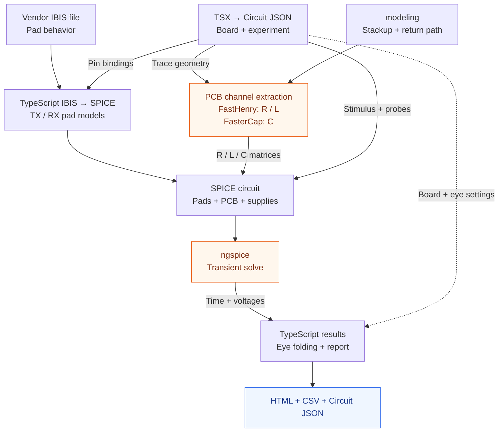
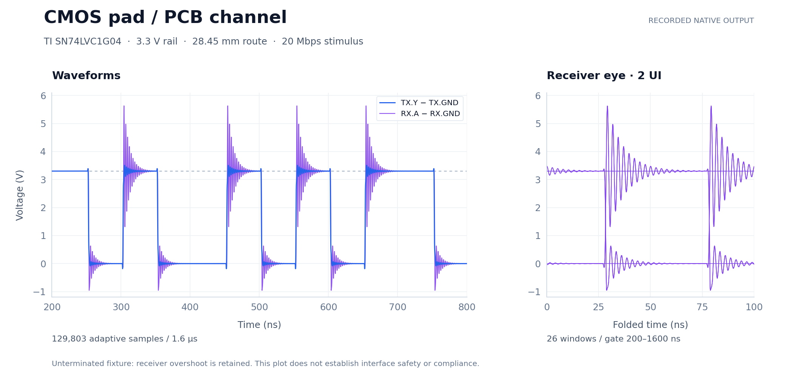

# IBIS + PCB simulation in tscircuit

Write the board and simulation in TSX, run the local solvers, then inspect the board, waveforms, eyes, and CSV data in a browser. This README walks through the API using a real TI IBIS model and recorded simulation output.

**Integration status:** the examples run locally against pinned PR previews of [core](https://github.com/tscircuit/core/pull/4765), [props](https://github.com/tscircuit/props/pull/945), and [Circuit JSON](https://github.com/tscircuit/circuit-json/pull/908). This is the API to review before upstream integration; use the checked-in lockfile.

## How the data flows



**IBIS describes the chip's electrical pads. The field solvers describe the PCB channel. ngspice solves them together.** FastHenry extracts resistance (R) and inductance (L); FasterCap extracts capacitance (C). The stimulus drives an output pad directly; this does not simulate the chip's internal digital logic. Orange boxes use separately installed native programs. The runner, IBIS conversion, and report generation use TypeScript; Python is not required.

## 1. Attach a real IBIS model

The [CMOS example](examples/single-ended/index.circuit.tsx) connects the output pad of `TX` to the input pad of `RX`. Both use TI's SN74LVC1G04 model. Setup downloads and extracts `sn74lvc1g04.ibs` using the URL and hashes in the [vendor lock](examples/vendor-models.lock.json).

This is the output-pad definition from [models.ts](examples/single-ended/models.ts), with the locked file/component names expanded:

```ts
import type { IbisModelDefinition } from "@tscircuit/props"

export const outputPad: IbisModelDefinition = {
  ibisModelAsset: {
    project_relative_path: "models/sn74lvc1g04.ibs",
    url: "./models/sn74lvc1g04.ibs",
    mimetype: "text/plain",
  },
  ibisComponentName: "LVC1G04_DCK",
  ibisPinNameToPortLabel: { "4": "Y", "5": "VCC", "3": "GND" },
  ibisPinNameToModelName: { "4": "LVC1G04_OUT_33" },
  ibisPinNameToReferencePortLabels: {
    "4": { pullup: "VCC", pulldown: "GND", powerClamp: "VCC", groundClamp: "GND" },
  },
  modelValueCorner: "typical",
  includePackageParasitics: false,
}
```

`project_relative_path` locates the extracted file from the project root. Pin `4` in the IBIS file binds to TSX port `Y`; its supply references bind to `VCC` and `GND`. The receiver definition in the same file selects pin `2` and model `LVC1G04_IN_33`.

The runner reads the local `.ibs` first. If it is missing, an HTTP(S) `ibisModelAsset.url` can provide the **plain IBIS file**; a vendor ZIP or download-page URL cannot. The examples prepare local files and check their expected hashes.

## 2. Declare the experiment in TSX

These declarations sit inside the CMOS example's `<board>`. The file imports `analog` from `@tscircuit/core` and `inputPad` / `outputPad` from `./models`:

```tsx
<>
  <ibismodel componentRef=".TX" {...outputPad} />
  <ibismodel componentRef=".RX" {...inputPad} />

  <analog.transientsimulation
    spiceEngine="pcb_spice"
    name="SI"
    duration="1600ns"
    timePerStep="50ps"
    ibisPinStates={{
      ".TX > .Y": { isOutput: true, isOutputEnabled: true },
      ".RX > .A": { isOutput: false },
    }}
  />
  <analog.digitalstimulus
    name="DATA"
    simulationRef=".SI"
    drives=".TX > .Y"
    unitInterval="50ns"
    startTime="0ns"
    initialState={0}
    pattern={{ type: "bits", bits: "001110100101011000101101", repeat: true }}
  />
  <voltageprobe name="DATA_RX" connectsTo=".RX > .A" referenceTo=".RX > .GND" />
  <analog.eyediagram
    name="CMOS_DATA"
    simulationRef=".SI"
    probeRef=".DATA_RX"
    unitInterval="50ns"
    timeOrigin="0ns"
    startTime="200ns"
    endTime="1600ns"
  />
</>
```

`ibismodel` binds pad behavior to a component. `transientsimulation` selects the engine, duration, maximum solver step, and pad states. `digitalstimulus` sets the transmitted bits. `voltageprobe` names the measured voltage; `eyediagram` folds that probe into two-bit windows over the chosen time range.

This excerpt omits the physical board, supplies, routes, and additional TX probe/eye. Run the [complete circuit](examples/single-ended/index.circuit.tsx), which also exports [`modeling`](examples/single-ended/simulation.config.ts). That configuration explicitly selects traces and defines the return conductor, stackup, materials, and extraction assumptions. These are still required by this local backend.

## 3. Run it and inspect the output

After [setup](#set-up-once), run the complete CMOS example:

```sh
pnpm simulate:single-ended --open
```

**`--open` opens the generated HTML report in your browser after the solve finishes.** Leave it off to save results without opening a browser. Each run creates a fresh folder and prints its location.



These are static plots of a recorded native run, not a report screenshot. [Source hashes](assets/simulation-api/cmos-output.source.json) identify the underlying CSV data. The interactive HTML adds the board view, experiment/probe selection, plot overlays, zoom/pan, and CSV downloads. Unused traces and components are gray; simulated ones are highlighted.

| Recorded CMOS result | Value |
| --- | --- |
| Selected route | `TX.Y → RX.A`, 28.45 mm |
| Run | 1.6 µs; 50 ps maximum integration step |
| Waveform data | 129,803 adaptive timestamps; TX and RX voltages |
| Receiver eye | 26 complete windows; 50 ns UI; 200–1600 ns gate |
| Receiver range | −0.955 to 5.629 V |

The unterminated fixture rings above its 3.3 V rail, and the selected input lacks a power-clamp table. The plot retains those excursions; it does not establish a safe interface or protocol compliance.

The saved run contains:

```text
dist/simulation-<timestamp>/
  results.html                Interactive results page
  circuit-results.json        Circuit JSON plus experiment/probe-linked voltage graphs
  csv/01-si-waveforms.csv      Actual timestamps and named probe voltages
  csv/01-si-eye-1.csv          Receiver eye windows
  csv/trace-map.csv           Simulated trace endpoints and dimensions
  csv/results-summary.csv     Voltage ranges by experiment and probe
  receipt.json               Inputs, solver evidence, and file hashes
  ...                        SPICE decks, geometry, R/L/C matrices, logs
```

For example, `csv/01-si-waveforms.csv` begins:

```csv
"time_s","DATA_RX_v","DATA_TX_v"
0,0.0016569380076181023,0.0016569319231534397
5e-13,0.0016569380076181008,0.0016569319231534395
```

Reopen `results.html` to inspect a saved run without solving again. Keep `csv/` beside it for downloads. Waveform timestamps are adaptive; eye samples are linearly interpolated from them. CSV units are seconds and volts unless a column says otherwise.

For integration, `circuit-results.json` preserves the circuit and adds `simulation_transient_voltage_graph` records linked to experiment and probe IDs. The HTML viewer is one consumer of the results; another tscircuit UI can consume those records directly.

## Set up once

You need Node.js **22.13 or newer**, Git, and pnpm **11.25.0**. On macOS, install Xcode command-line tools and [Homebrew](https://brew.sh/) first. On Debian/Ubuntu, setup needs access to `sudo apt-get` or root.

```sh
git clone https://github.com/0hmX/am3352-ddr-eye.git
cd am3352-ddr-eye
npm install --global pnpm@11.25.0
pnpm install --frozen-lockfile
pnpm simulate:setup --install-deps
```

The last command downloads vendor models and builds FastHenry, FasterCap, and ngspice locally. `--install-deps` installs their compiler/build dependencies; omit it if those are already installed. External solvers are not bundled. Setup and solves can take several minutes. macOS Apple Silicon is validated; Linux setup is implemented but not validated end to end. The installer does not support Windows.

## Run each example

Run from the repository folder. Every command opens that example's **simulation results**:

| Circuit file | Command | What opens |
| --- | --- | --- |
| [index.circuit.tsx](index.circuit.tsx) | `pnpm simulate --open` | AM3352 DDR strobe: DQS/DQSn, two selected traces; TX/RX waveforms and eyes |
| [examples/ddr-dq/index.circuit.tsx](examples/ddr-dq/index.circuit.tsx) | `pnpm simulate:ddr-dq --open` | DQ0 + DQS + DQSn, three selected traces; quiet and switching experiments |
| [examples/single-ended/index.circuit.tsx](examples/single-ended/index.circuit.tsx) | `pnpm simulate:single-ended --open` | SN74LVC1G04 CMOS pad/channel; TX/RX waveforms and eyes |
| [examples/differential-data/index.circuit.tsx](examples/differential-data/index.circuit.tsx) | `pnpm simulate:non-ddr --open` | SN65HVD72 RS-485 pair, termination, differential and A-to-ground results |

For the **circuit design preview**, run `pnpm dev`. It opens `index.circuit.tsx` by default; it does not run the native simulation.

### Compare quiet versus switching neighbors

```sh
pnpm simulate:ddr-dq --out .tscircuit/ddr
pnpm simulate:compare .tscircuit/ddr --probe DQ0_RX --open
```

The first command saves both DDR experiments. `--out` chooses a folder that must not already exist; choose a new name for another run. The second opens their DQ0 receiver comparison and exports `comparison.csv`.

| Recorded DQ0 receiver comparison | Value |
| --- | --- |
| Simulated traces | DQ0 victim, DQS and DQSn neighbors |
| Conditions | Same victim traffic, models, rails, and geometry; neighbor traffic changes |
| Measurement gate | 40–160 ns |
| Peak absolute switching − quiet difference | 6.054 mV |
| Time RMS difference | 1.595 mV |

These are observed voltage differences for the reduced channel, not eye-opening or BER measurements. Comparison requires a ground-referenced single-ended victim and uses linear interpolation on the union of recorded timestamps, with RMS integrated over time.

<details>
<summary>Troubleshooting and validation commands</summary>

| Problem | Action |
| --- | --- |
| Command not found | Run from the repository after `pnpm install --frozen-lockfile`; check Node ≥22.13 and pnpm 11.25.0. |
| Missing solvers | Finish `pnpm simulate:setup`; check with `pnpm exec pcb-spice-pipeline --check-tools`. |
| Missing/changed IBIS file | Run `pnpm simulate:models`. |
| Browser does not open | Open the printed `results.html` path; Linux automatic opening uses `xdg-open`. |
| Setup/solver fails | Read the stdout/stderr log paths printed in the error. |

```sh
pnpm typecheck
pnpm build
pnpm test:native
pnpm simulate:prove
```

`test:native` requires prepared models and installed solvers. `simulate:prove` runs all four examples twice and audits the results. Unit tests use `pnpm test` and additionally require Bun; normal simulation does not.

Tools live under `node_modules/.cache/pcb-spice-pipeline/tools`. `PCB_SPICE_CACHE` changes the runtime cache location. For an explicit tools installation:

```sh
pnpm simulate:setup --tools-dir /absolute/path/to/tools
PCB_SPICE_TOOLS=/absolute/path/to/tools/tools.json pnpm simulate:ddr-dq --open
```

Setup verifies pinned sources, binaries, and installed runtime libraries. Local/user ngspice startup files are ignored and runtime-library overrides are rejected. The [toolchain lock](packages/pcb-spice-pipeline/toolchain-lock.json) records sources and licenses. Vendor bytes are fetched locally and are not redistributed here.

</details>

<details>
<summary>Saved boards and current modeling limits</summary>

For saved boards, place simulation declarations inside `<ImportedBoard circuitJson={savedBoard}>`, imported from `pcb-spice-pipeline/tsx`; see the [DDR example](examples/ddr-dq/index.circuit.tsx). It preserves physical records and verifies referenced pin/net mappings. Additional physical children, ambiguous bindings, and existing saved simulation declarations/results are rejected. Use selectors such as `chip.U1` when BGA pin names could also match `.U1`.

The backend supports **one to three selected coupled channels**, unswept transient experiments, mutual R/L/C coupling, and an explicit finite return conductor. Gray traces remain visible but are excluded from the electrical solve.

Routed lengths/widths are straightened into stages with assumed spacing, homogeneous effective dielectric, and fixed-frequency R/L. Full planes, unselected nets, dielectric loss, copper roughness, complete via pads/stubs, and the board PDN are omitted. Reference rails use explicit ideal supplies; example package-parasitic omissions are recorded in the receipt. The DDR example assumes 0.75 mm center spacing and continuous write-direction pad activity. Controller logic, commands, bursts, training, and clock recovery are not modeled. Its source is an incomplete routing checkpoint; preview shows saved footprints as generic chips.

Eyes show finite observed transients, without BER extrapolation, protocol compliance, or a hardware accuracy claim. IBIS currents outside characterized voltage ranges hold the endpoint current, with that approximation recorded.

</details>
