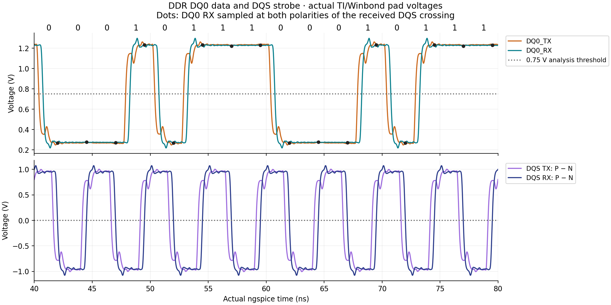
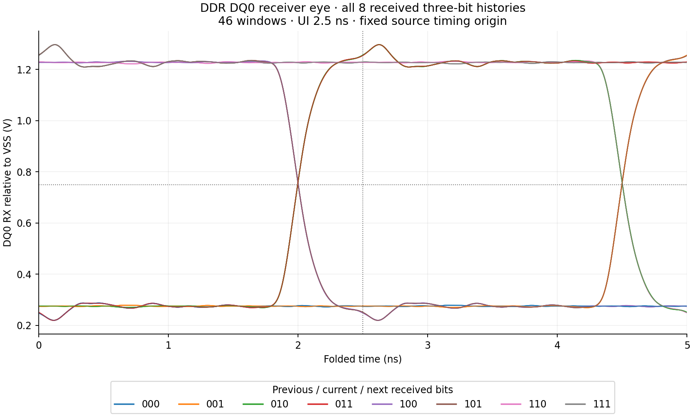
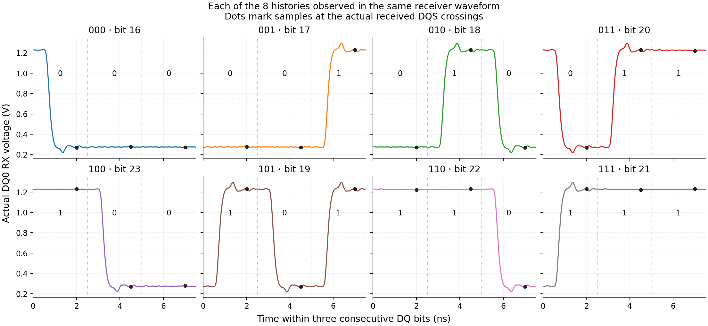

# DDR DQ0 data eye with a DQS strobe

A normal tscircuit TSX example using the published AM3352 board's routed DQ0 and differential DQS traces. It uses the shared PCB extraction, IBIS converter and native SPICE pipeline.

## Run

From the repository root:

```sh
pnpm install --frozen-lockfile
pnpm simulate:setup
pnpm simulate:ddr-dq
# Optional explicit fresh destination:
pnpm simulate:ddr-dq dist/my-ddr-dq-proof
```

The command executes two fresh FastHenry, FasterCap and ngspice runs, compares their outputs, independently audits the physical mapping and eye samples, then verifies the received bits and generates plots. Existing output directories are rejected. Vendor downloads and installed tools can be cached; solver results are recomputed.

Native jobs have a 15-minute wall-clock limit, recorded in their command receipts. A positive integer `PCB_SPICE_TIMEOUT_MS` overrides it for slower machines.

For the ordinary board preview, run `pnpm dev --port 3091` and select `examples/ddr-dq/index.circuit.tsx`.

## Signals and vendor models

| Signal | TI AM335x pin | TI model | Winbond W631GG6MB-12 pin | Winbond model |
| --- | --- | --- | --- | --- |
| DQ0 | U1.M3 / DDR_D0 | Model_343 | U3.E3 / DQL0 | ODT_60 |
| DQS positive | U1.P1 / DDR_DQS0 | Model_655 | U3.F3 / DQSL | ODT_60 |
| DQS negative | U1.P2 / DDR_DQSN0 | Model_847 | U3.G3 / DQSL# | ODT_60 |

[simulation.config.ts](simulation.config.ts) extends the shared, hash-locked [TI and Winbond definitions](../../simulation.config.ts). The selected TI settings are 1.5 V, slow, 9 mA, 5%; the Winbond inputs use 60 Ω ODT. These are explicit experiment settings rather than verified firmware settings.

DQ0 repeats `00010111` at 2.5 ns per bit (400 Mbit/s). Its cyclic three-bit windows cover `000, 001, 010, 011, 100, 101, 110, 111`. DQS remains `01`, with its negative leg inverted, giving a 200 MHz differential strobe. Starting DQS at 1.25 ns places its nominal edges halfway into DQ bits. Vendor buffer and channel delays remain in the simulated waveforms.

The transient lasts 160 ns; the eye observation begins at 40 ns. Both polarities of the actual received DQS zero crossing sample DQ0, using an explicit 0.75 V analysis threshold (ideal VDDQ/2). Verification requires consecutive correct received bits and all eight histories in both the sampled bits and the existing two-UI eye windows.

## Executed results

The checked-in [proof summary](results/proof-summary.json) records the fresh-run counts, matching output hashes, vendor sources and physical pin selections, executed source hashes, tool hashes and plot hashes. These images are generated from those solver waveforms.

Both fresh runs produced 163,305 waveform samples, 48 correctly received bits sampled at DQS crossings, and 46 DQ eye windows containing all eight histories. The comparison matched 56 generated files byte for byte.







Re-running writes full evidence under the printed `dist/ddr-dq-*/` directory: `run-a/`, `run-b/`, `repeatability.json`, `independent-audit.json`, `dq-coverage.json`, `proof-summary.json` and `plots/`. Each run retains original vendor bytes, field-solver inputs/results, the SPICE deck, raw `waveform.dat`/`waveform.csv`, and eye samples. Large generated runs and manufacturer model files are not committed.

## Modeling limits

This is a continuous write-direction pad/channel experiment. It omits DDR commands, burst gating, preamble/postamble, training and controller/memory logic. The eye uses its declared fixed source timing origin; sampling with received DQS does not add clock recovery.

The board's actual routed lengths, widths and layer transitions are retained, then straightened into stages. DQ0, DQS and DQSn are modeled at an assumed uniform 0.75 mm center spacing with a finite shared return strip. This is not their actual varying spacing or a complete plane/PDN extraction. Supplies are ideal, package parasitics are explicitly omitted, and R/L are fixed at 100 MHz. There is no injected random jitter or noise, BER extrapolation, DDR compliance claim or hardware correlation. The short pattern covers three-bit histories; longer histories can still matter.

The original saved board is an incomplete routing checkpoint, not an independently validated board. See the shared [construction assumptions](../../board-construction.json) and [source provenance](../../source-provenance.json).
